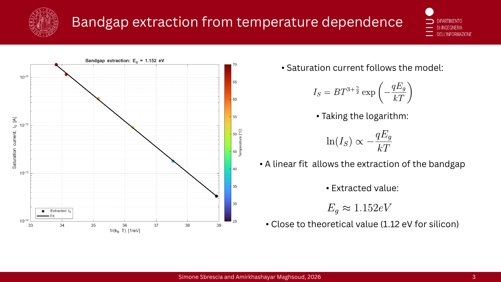
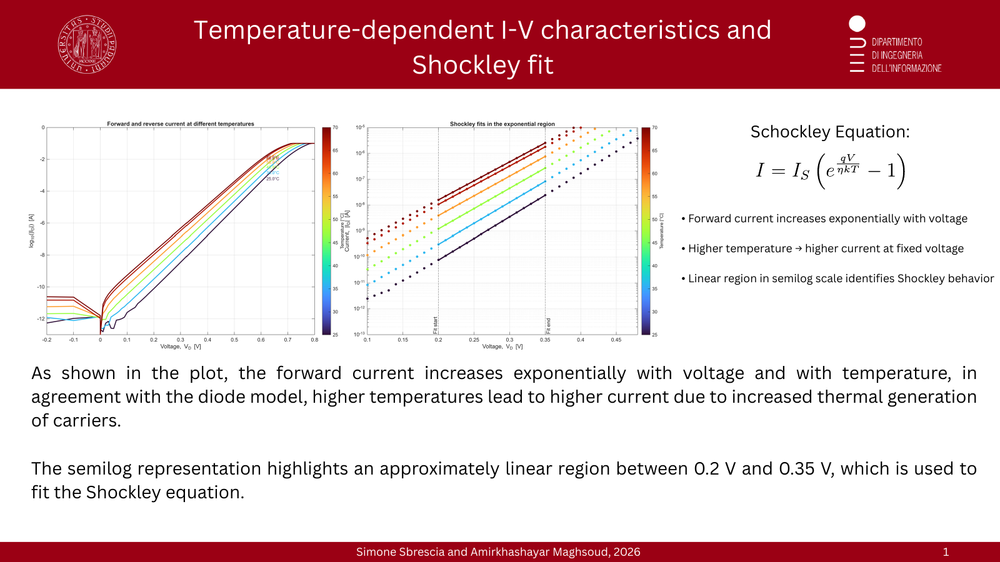
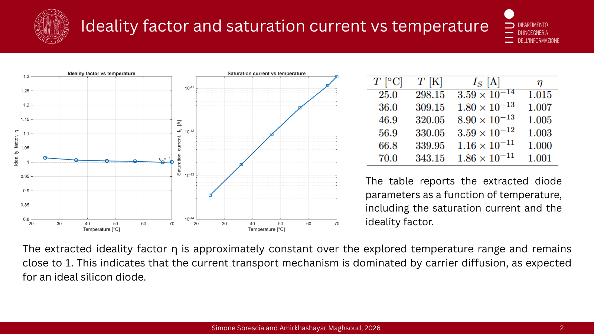
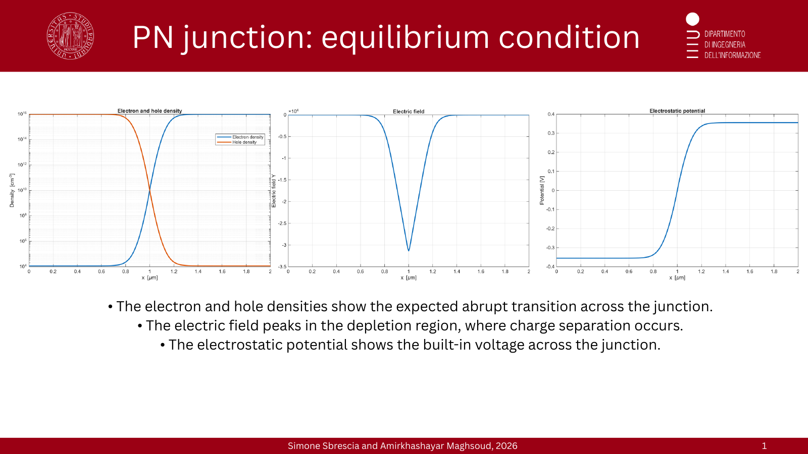
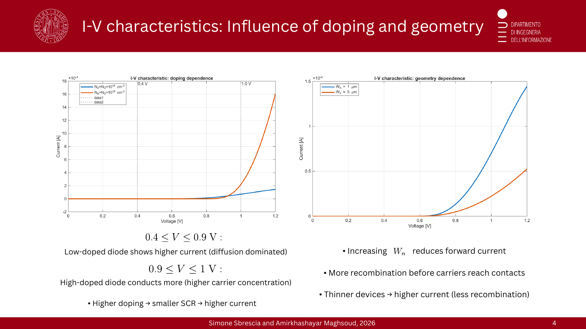

# 01 — PN Junction: Silicon Bandgap Extraction and TCAD Study

[Full report (PDF)](report.pdf) · April 2026

## A. Lab: extracting the silicon bandgap from diode I–V(T)

**Goal:** measure the energy gap of silicon using only the electrical response of a diode.

**Method**
1. Measure forward and reverse I–V of a Si diode at six temperatures from 25 °C to 70 °C.
2. Fit the Shockley equation, I = IS(eqV/ηkT − 1), in the linear semilog region (0.20–0.35 V) to get IS and η at each temperature.
3. Use the model IS = B·T3+γ/2·exp(−qEg/kT) and fit ln IS against 1/kT. The slope gives Eg.

**Results**

| T [°C] | IS [A] | η |
|---|---|---|
| 25.0 | 3.59×10-14 | 1.015 |
| 36.0 | 1.80×10-13 | 1.007 |
| 46.9 | 8.90×10-13 | 1.005 |
| 56.9 | 3.59×10-12 | 1.003 |
| 66.8 | 1.16×10-11 | 1.000 |
| 70.0 | 1.86×10-11 | 1.001 |

- **Eg ≈ 1.152 eV**, about 3 % above the textbook 1.12 eV for silicon.
- η stays close to 1 at every temperature, so transport is dominated by diffusion, as expected for an ideal Si diode.

## B. TCAD: PN junction physics

- **Equilibrium:** carrier densities, electric field and electrostatic potential across the junction. The field peaks in the depletion region.
- **Band diagram:** built-in potential and space-charge-region width read from the simulation and compared with analytical expressions.
- **I–V:** exponential forward current; series resistance bends the semilog curve near 0.7–0.8 V.
- **Parametric study:** effect of doping level, device length and material (Si vs Ge). Ge's smaller bandgap gives a higher intrinsic carrier density, so it has a lower forward voltage and a higher current.

**Authors:** A. Maghsoud, S. Sbrescia
