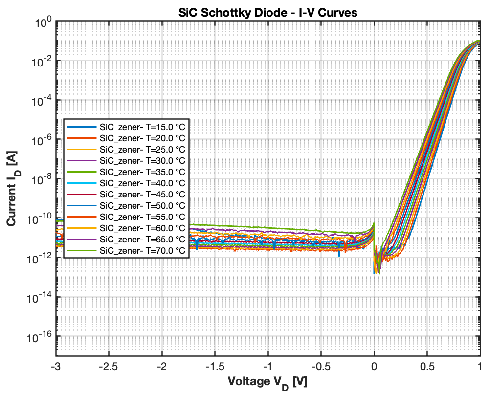
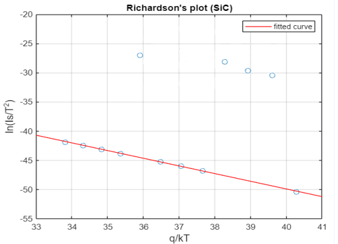
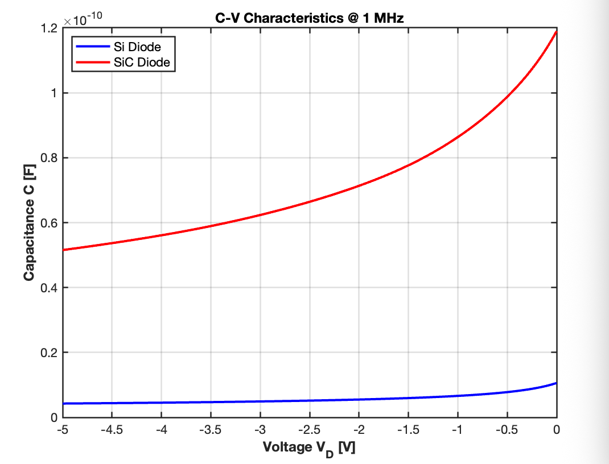
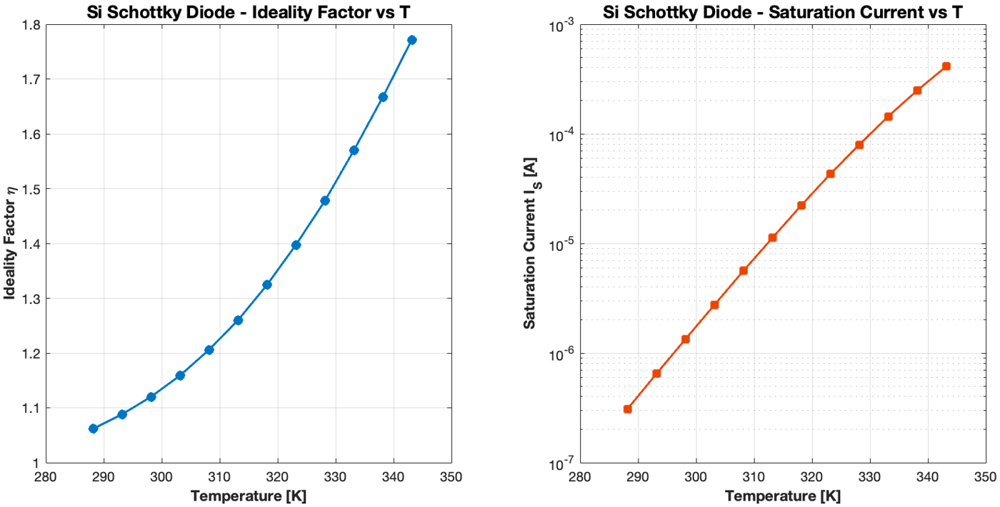
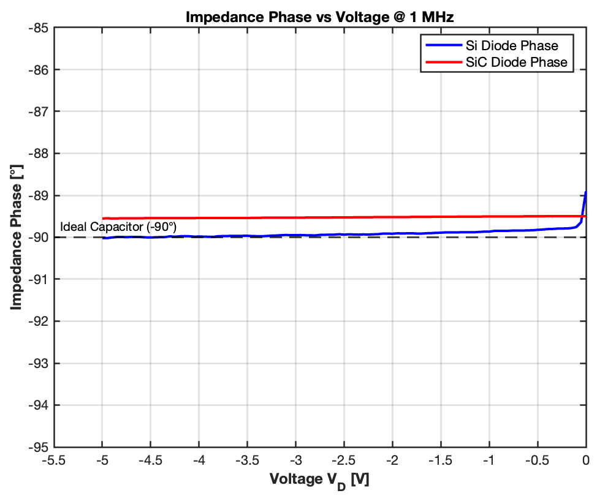
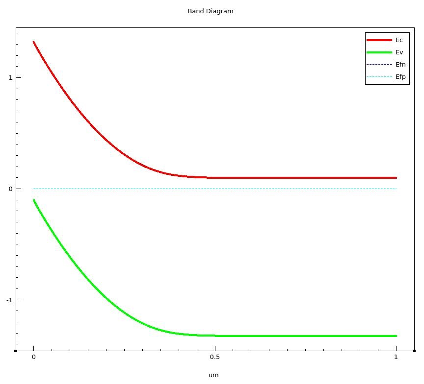
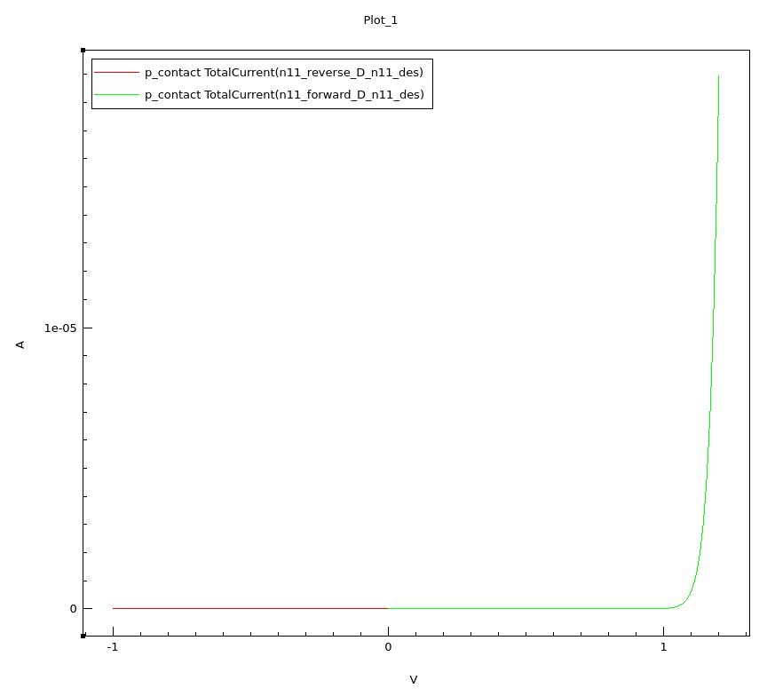
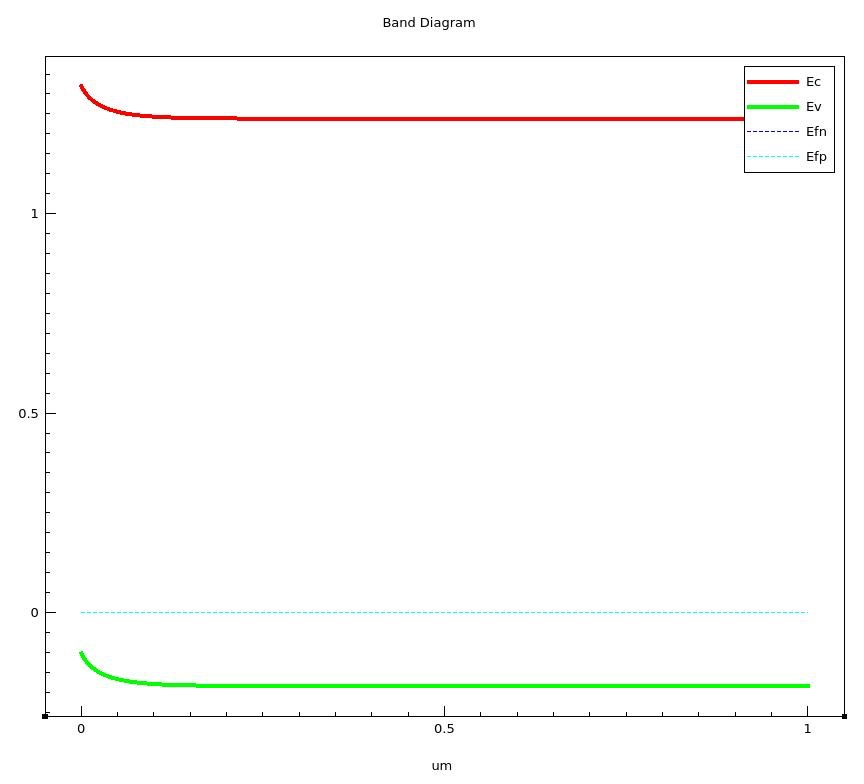
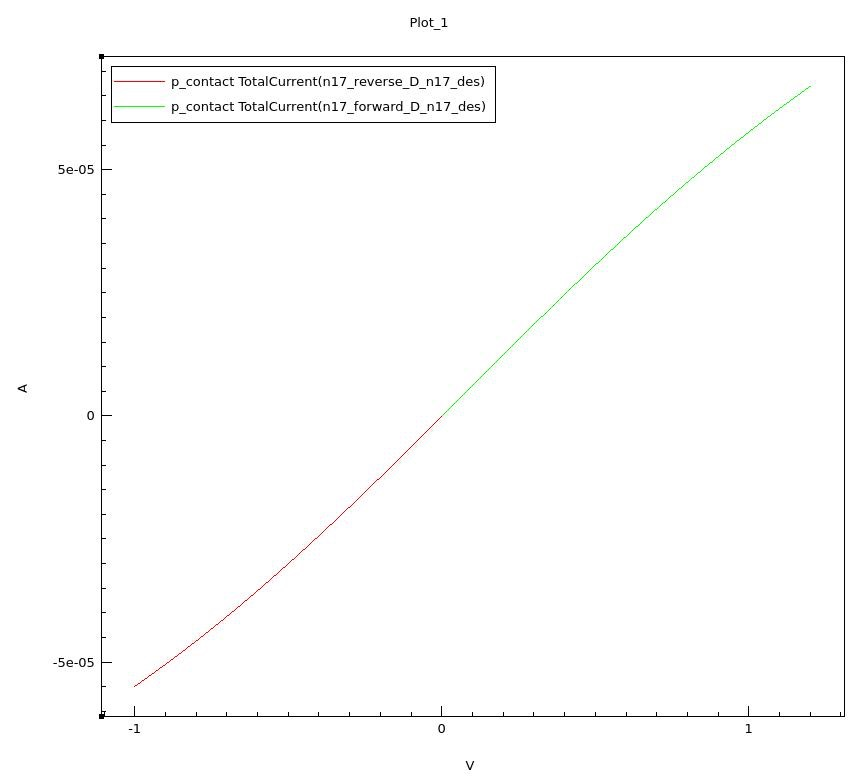
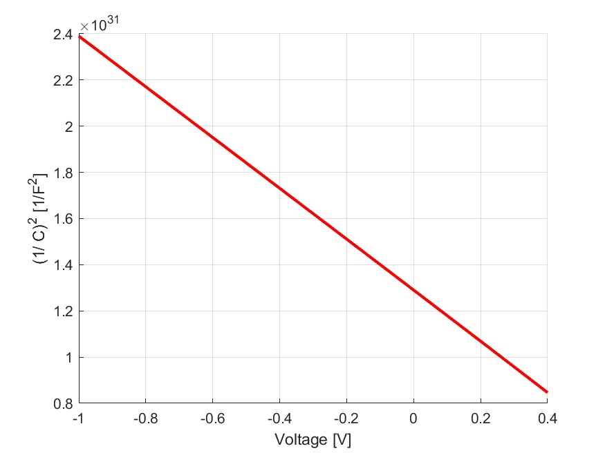

# Module 02: Si and SiC Schottky diodes and Au/GaAs contacts in TCAD

[Full report (PDF)](report.pdf) · May 2026

## A. Lab: silicon and silicon-carbide Schottky diodes

The goal is to compare a Si diode with a wide-bandgap SiC diode and extract their barrier and doping parameters.

1. We measured I–V on a Peltier stage from 15 °C to 70 °C, with LabVIEW running the sweeps.
2. A Shockley fit at each temperature gives η(T) and IS(T).
3. On a Richardson plot of ln(IS/T²) against q/kT, the slope gives the Schottky barrier height.
4. We measured C–V at 1 MHz and fitted 1/C² against V. The x-intercept gives Vbi and the slope gives the doping, and from both we computed the effective area.
5. The impedance phase stays near −90° over the whole bias range, so the diodes respond as pure capacitances.

<table>
<tr>
<td width="50%"></td>
<td width="50%"></td>
</tr>
<tr>
<td align="center">Si diode, 15–70 °C</td>
<td align="center">SiC diode, 15–70 °C</td>
</tr>
<tr>
<td width="50%"></td>
<td width="50%"></td>
</tr>
<tr>
<td align="center">Richardson plot, Si</td>
<td align="center">Richardson plot, SiC</td>
</tr>
</table>

### Results

| Parameter | Si | SiC |
|---|---|---|
| Built-in potential Vbi | 0.40 V | 2.86 V |
| Mott–Schottky slope | 8.85×1021 F-2V-1 | 6.11×1019 F-2V-1 |
| Doping ND | 1.67×1015 cm-3 | 5.93×1015 cm-3 |
| Effective area | 0.09 mm² | 0.63 mm² |

The SiC diode has a much higher barrier than the Si diode, as its wider bandgap predicts. For both devices 1/C² is linear in deep reverse bias, which means the doping is uniform.

<table>
<tr>
<td width="50%"></td>
<td width="50%"></td>
</tr>
<tr>
<td align="center">C–V at 1 MHz</td>
<td align="center">Mott–Schottky (1/C²) fits</td>
</tr>
<tr>
<td width="50%"></td>
<td width="50%"></td>
</tr>
<tr>
<td align="center">Si: η and IS vs temperature</td>
<td align="center">Impedance phase at 1 MHz</td>
</tr>
</table>

## B. TCAD: Au/GaAs junction in Sentaurus

Gold has a work function of 5.47 eV. On n-type GaAs the bands bend upward, a Schottky barrier forms and the I–V rectifies. On p-type GaAs the holes see no significant barrier and the I–V is linear. The same metal gives a rectifying or an ohmic contact depending on the doping type.

<table>
<tr>
<td width="50%"></td>
<td width="50%"></td>
</tr>
<tr>
<td align="center">Au / n-GaAs: band diagram</td>
<td align="center">Au / n-GaAs: rectifying I–V</td>
</tr>
<tr>
<td width="50%"></td>
<td width="50%"></td>
</tr>
<tr>
<td align="center">Au / p-GaAs: band diagram</td>
<td align="center">Au / p-GaAs: ohmic I–V</td>
</tr>
</table>

The simulated capacitance falls with reverse bias and 1/C² is linear, as expected for uniform doping. At 1020 cm-3 with the tunnelling model on, the depletion width, which scales as 1/√N, becomes thin enough for field emission. The contact then turns ohmic even with a high-work-function metal. Real ohmic contacts rely on the same effect.

<table>
<tr>
<td width="50%"></td>
<td width="50%"></td>
</tr>
<tr>
<td align="center">Simulated 1/C² vs V</td>
<td align="center">I–V with and without heavy doping (tunnelling)</td>
</tr>
</table>

Authors: L. Ferrari, A. Maghsoud, S. Sbrescia
