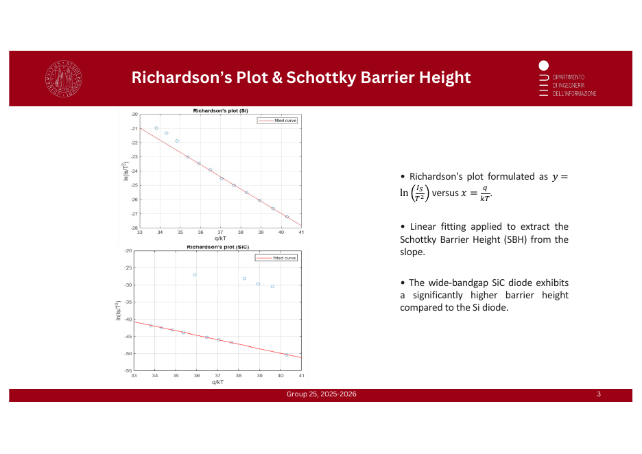
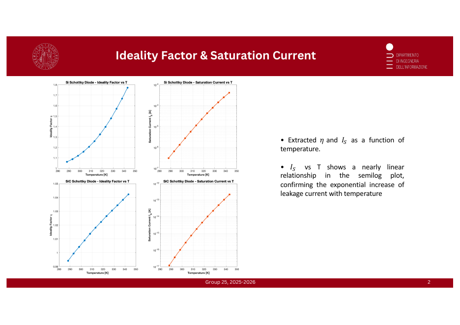
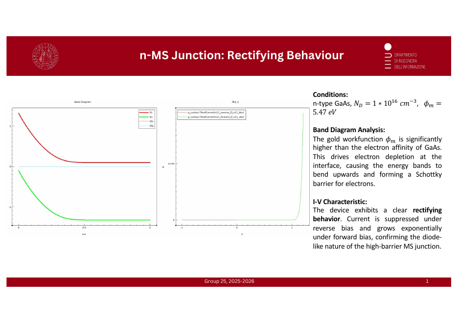
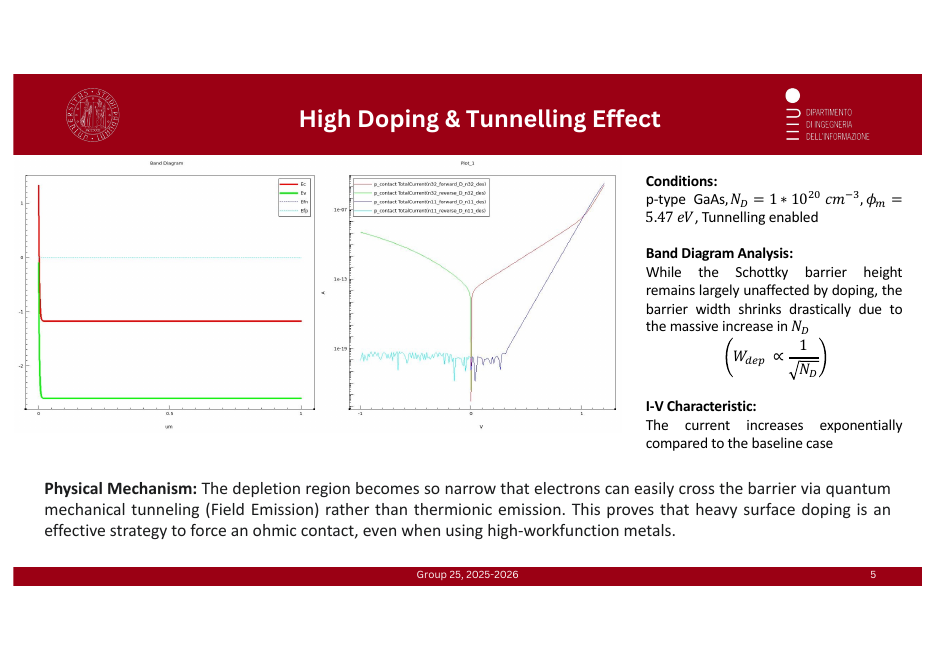
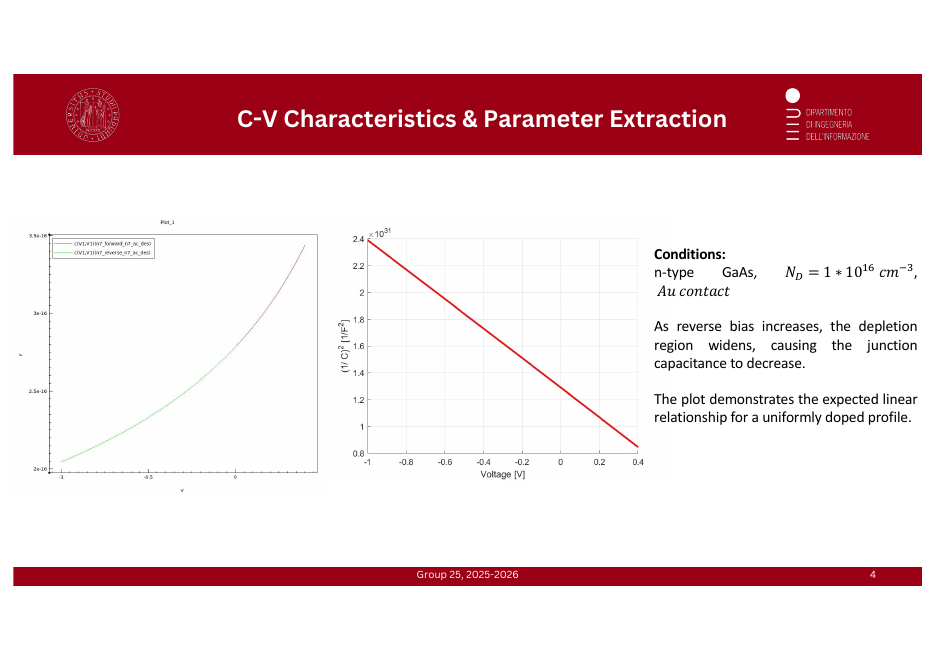

# 02 — Metal–Semiconductor Contacts: Si/SiC Schottky Diodes and Au/GaAs TCAD

[Full report (PDF)](report.pdf) · May 2026

## A. Lab: silicon vs silicon-carbide Schottky diodes

**Goal:** compare a Si and a wide-bandgap SiC Schottky diode and extract their barrier and doping parameters.

**Method**
1. Measure I–V on a Peltier-controlled stage across temperature (automated LabVIEW sweeps).
2. Fit the Shockley equation at each temperature to get η(T) and IS(T).
3. Build a **Richardson plot**, ln(IS/T²) against q/kT. Its slope gives the Schottky barrier height (SBH).
4. Measure C–V at 1 MHz, then use a **Mott–Schottky** (1/C² vs V) fit. The x-intercept gives Vbi and the slope gives the doping, which together give the effective device area.
5. Check that the impedance phase stays near −90° (pure capacitive response) across the bias range.

**Results**

| Parameter | Si | SiC |
|---|---|---|
| Built-in potential Vbi | 0.40 V | 2.86 V |
| Mott–Schottky slope | 8.85×1021 F-2V-1 | 6.11×1019 F-2V-1 |
| Doping ND | 1.67×1015 cm-3 | 5.93×1015 cm-3 |
| Effective area | 0.09 mm² | 0.63 mm² |

- The SiC diode has a much higher barrier height than the Si diode, in line with its wide bandgap.
- 1/C² is linear in deep reverse bias for both devices, which indicates uniform doping.

## B. TCAD: Au/GaAs metal–semiconductor junction

- **n-type GaAs + Au (φm = 5.47 eV):** upward band bending forms a Schottky barrier, and the I–V is clearly rectifying.
- **p-type GaAs + Au:** no significant barrier for holes, and the I–V is linear (ohmic). The same metal gives opposite contact types depending on the semiconductor's doping type.
- **C–V:** capacitance falls with reverse bias, and 1/C² is linear for uniform doping.
- **Heavy doping (1020 cm-3) with tunnelling enabled:** the depletion width (W ∝ 1/√N) becomes thin enough for field emission. The contact turns ohmic even with a high-work-function metal, which is the physics behind real ohmic contacts.

**Authors:** L. Ferrari, A. Maghsoud, S. Sbrescia
