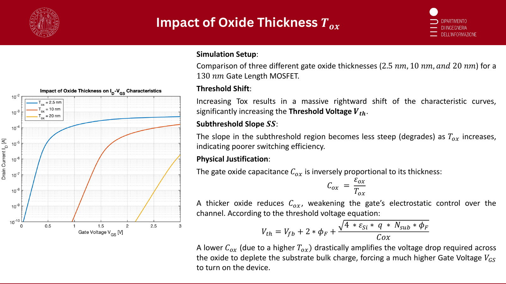
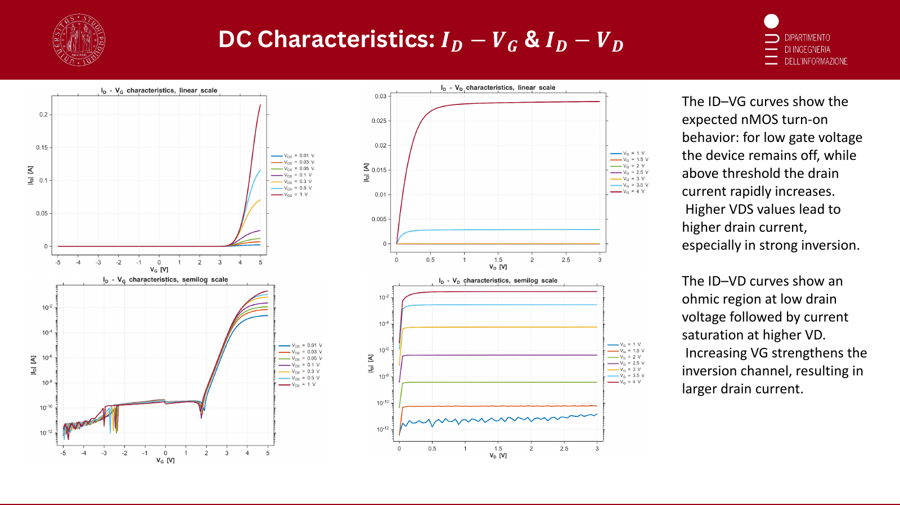
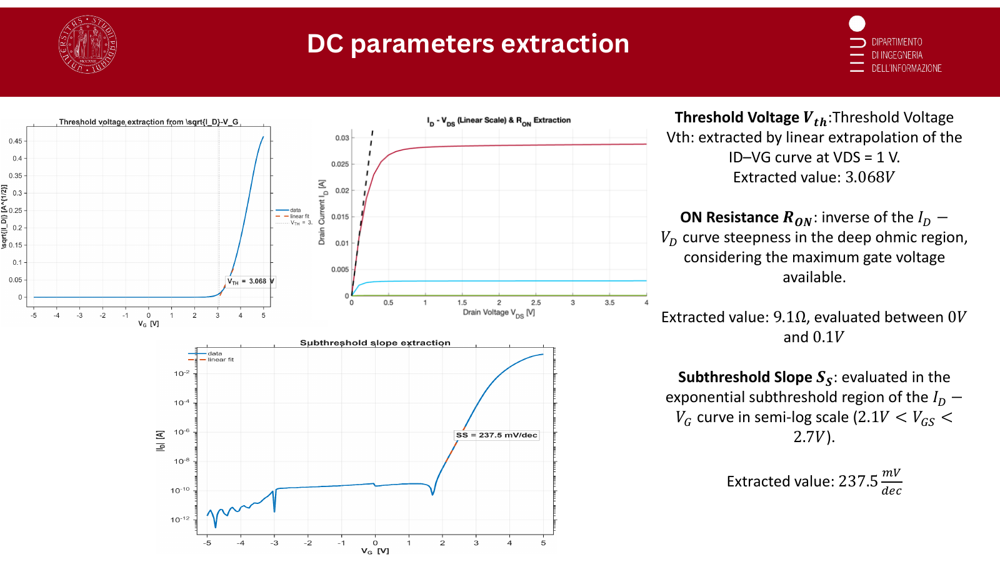
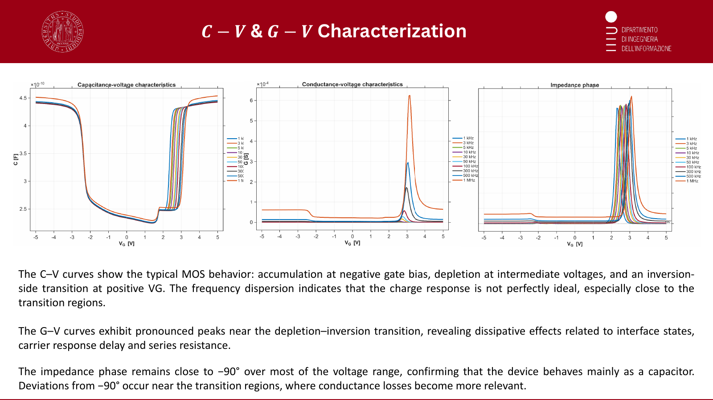
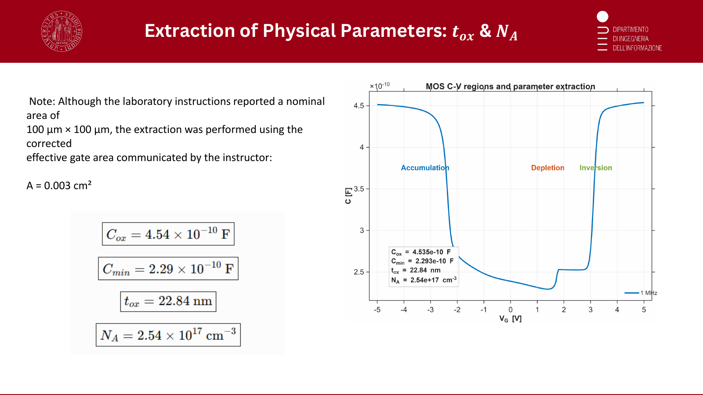

# 03 — MOSFET: TCAD Design Study and Experimental DC/AC Characterization

[Full report (PDF)](report.pdf) · June 2026

## A. TCAD: 130 nm n-MOSFET

- **Band diagrams** along vertical and horizontal cutlines at equilibrium, at VGS = 1.5 V / VDS = 0, and at VGS = VDS = 1.5 V. They show inversion forming, and the quasi-Fermi levels splitting once current flows.
- **Substrate doping sweep** (1017, 5×1017, 1018 cm-3; LG = 130 nm, tox = 2.5 nm): Vth falls as Nsub falls, because there is less bulk depletion charge and a smaller φF.
- **Oxide thickness sweep** (2.5, 10, 20 nm): thicker oxide lowers Cox and weakens gate control. Vth rises sharply and the subthreshold slope degrades.

Both trends are explained with Vth = VFB + 2φF + √(4εSiqNsubφF)/Cox.

## B. Lab: experimental DC and AC characterization

**DC**

| Parameter | Method | Value |
|---|---|---|
| Threshold voltage Vth | Linear extrapolation of ID–VG at VDS = 1 V | **3.068 V** |
| On-resistance RON | Inverse slope of ID–VD in deep ohmic region (0–0.1 V, max VG) | **9.1 Ω** |
| Subthreshold slope SS | Semilog ID–VG, 2.1 V < VGS < 2.7 V | **237.5 mV/dec** |

Transconductance gm rises with VDS and then drops at high VGS because of mobility degradation (surface scattering in the strong vertical field).

**AC (MOS capacitor)**

- Multi-frequency C–V shows accumulation, depletion and inversion. G–V peaks near the depletion–inversion transition point to interface states and series resistance.
- **1 MHz C–V hysteresis:** a flat-band shift between forward and backward sweeps, caused by charge trapping at the Si/SiO₂ interface and in the oxide.
- **Parameter extraction** (effective area 0.003 cm²): Cox = 4.54×10-10 F, Cmin = 2.29×10-10 F → **tox = 22.84 nm**, **NA = 2.54×1017 cm-3**.

**Authors:** L. Ferrari, A. Maghsoud, S. Sbrescia
