# Module 03: MOSFET in TCAD and DC/AC characterization in the lab

[Full report (PDF)](report.pdf) · June 2026

## A. TCAD: 130 nm n-MOSFET in Sentaurus

We took band diagrams along vertical and horizontal cutlines in three bias conditions: equilibrium, VGS = 1.5 V with VDS = 0, and VGS = VDS = 1.5 V. They show the inversion layer forming, and the quasi-Fermi levels splitting once current flows.

<table>
<tr>
<td width="33%">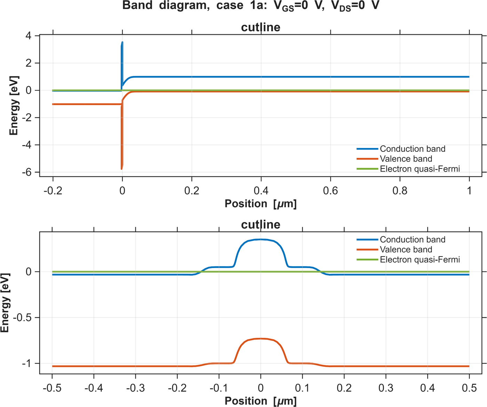</td>
<td width="33%">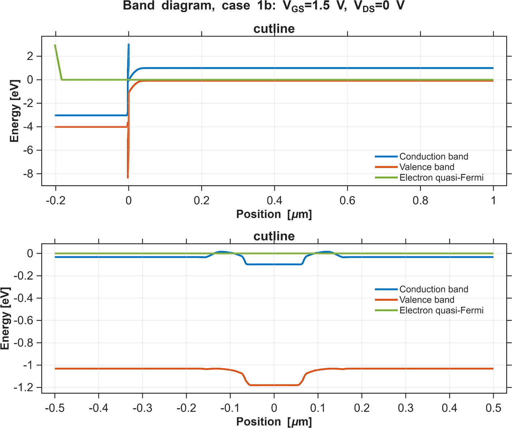</td>
<td width="33%">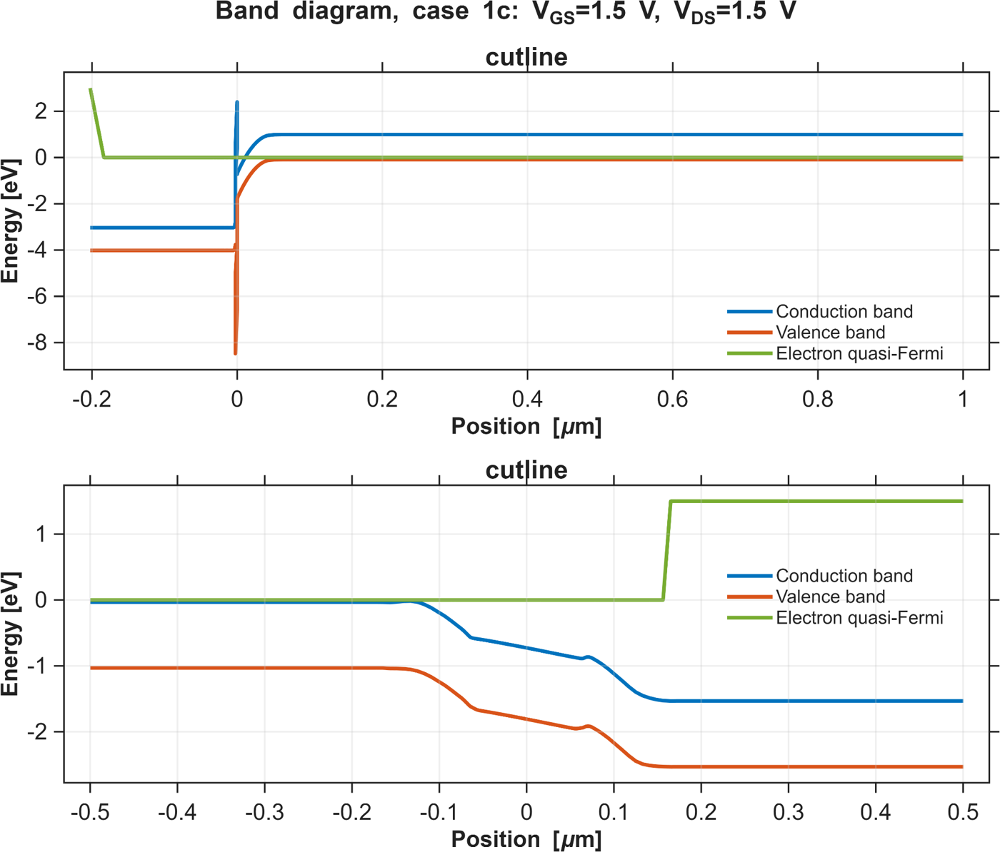</td>
</tr>
<tr>
<td align="center">Equilibrium</td>
<td align="center">VGS = 1.5 V, VDS = 0</td>
<td align="center">VGS = VDS = 1.5 V</td>
</tr>
</table>

We then swept the substrate doping over 1017, 5×1017 and 1018 cm-3, with LG = 130 nm and tox = 2.5 nm. Vth falls with Nsub because the bulk depletion charge and φF both shrink. A sweep of the oxide thickness over 2.5, 10 and 20 nm shows the opposite: a thicker oxide lowers Cox, weakens gate control, raises Vth sharply and degrades the subthreshold slope.

Both trends follow from Vth = VFB + 2φF + √(4εSiqNsubφF)/Cox.

<table>
<tr>
<td width="50%">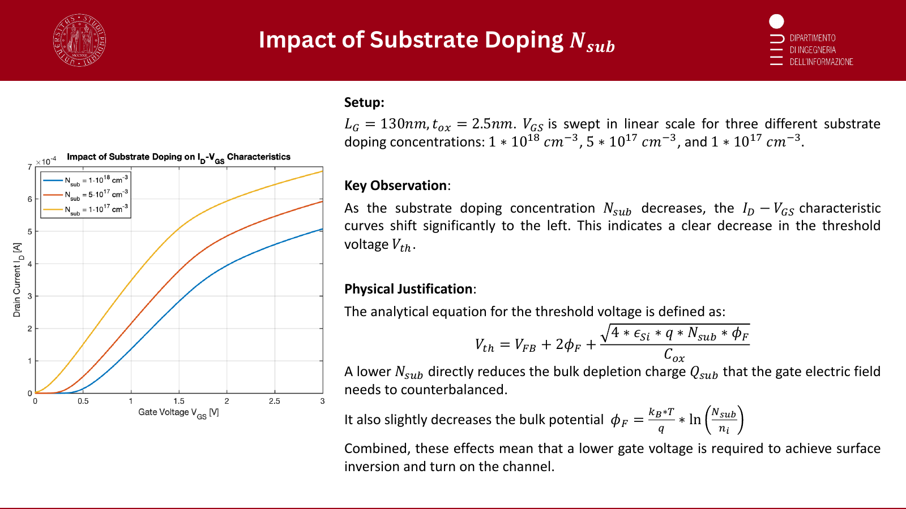</td>
<td width="50%"></td>
</tr>
<tr>
<td align="center">ID–VGS vs substrate doping</td>
<td align="center">ID–VGS vs oxide thickness</td>
</tr>
</table>

## B. Lab: experimental DC and AC characterization

### DC

| Parameter | Method | Value |
|---|---|---|
| Threshold voltage Vth | Linear extrapolation of ID–VG at VDS = 1 V | 3.068 V |
| On-resistance RON | Inverse slope of ID–VD from 0 to 0.1 V at the highest VG | 9.1 Ω |
| Subthreshold slope SS | Semilog ID–VG, 2.1 V < VGS < 2.7 V | 237.5 mV/dec |

<table>
<tr>
<td width="50%">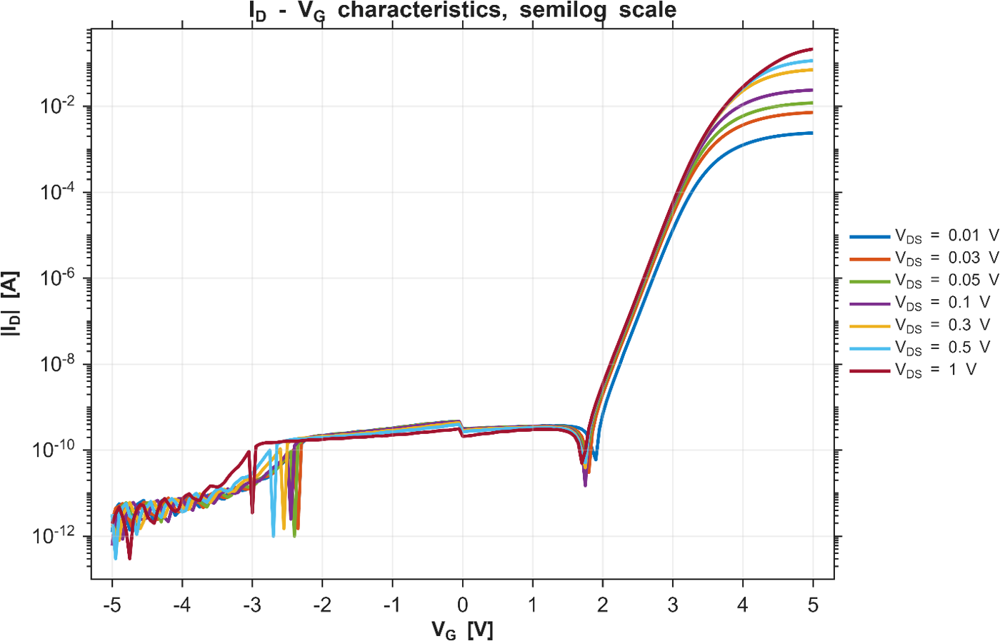</td>
<td width="50%">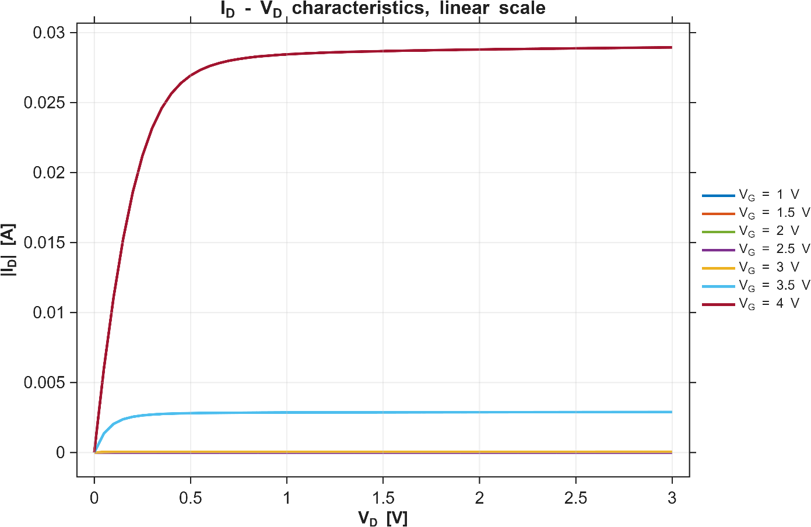</td>
</tr>
<tr>
<td align="center">ID–VG, semilog</td>
<td align="center">ID–VD, linear</td>
</tr>
<tr>
<td width="50%">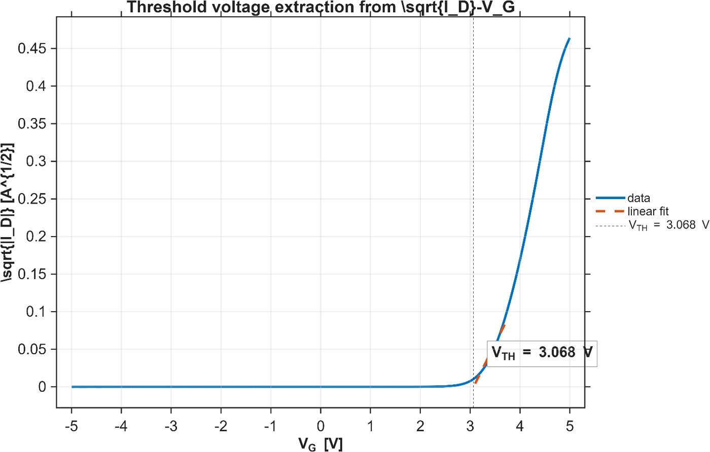</td>
<td width="50%">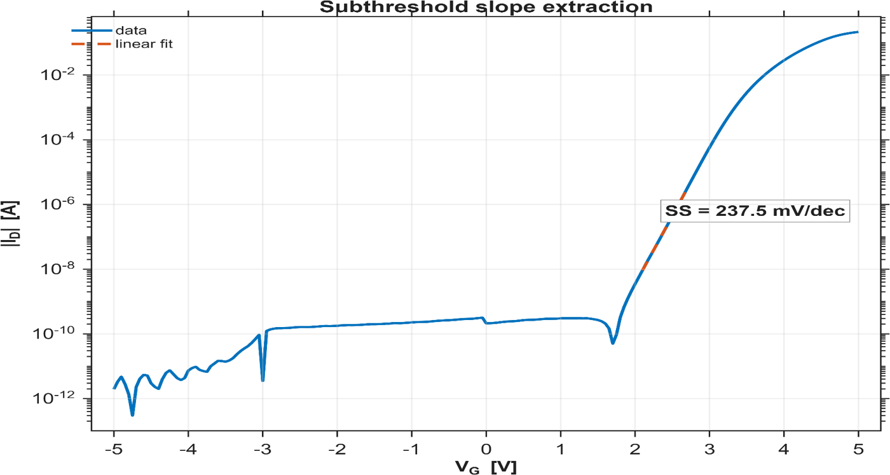</td>
</tr>
<tr>
<td align="center">Vth extraction</td>
<td align="center">Subthreshold slope extraction</td>
</tr>
</table>

The transconductance gm rises with VDS. At high VGS it drops, because the strong vertical field increases surface scattering and lowers the mobility.

### AC, MOS capacitor

C–V from 1 kHz to 1 MHz shows accumulation, depletion and inversion. The G–V peaks near the depletion–inversion transition point to interface states and series resistance. At 1 MHz the forward and backward sweeps differ by a flat-band shift, which comes from charge trapping at the Si/SiO₂ interface and in the oxide.

With an effective area of 0.003 cm², Cox = 4.54×10-10 F and Cmin = 2.29×10-10 F give tox = 22.84 nm and NA = 2.54×1017 cm-3.

<table>
<tr>
<td width="50%">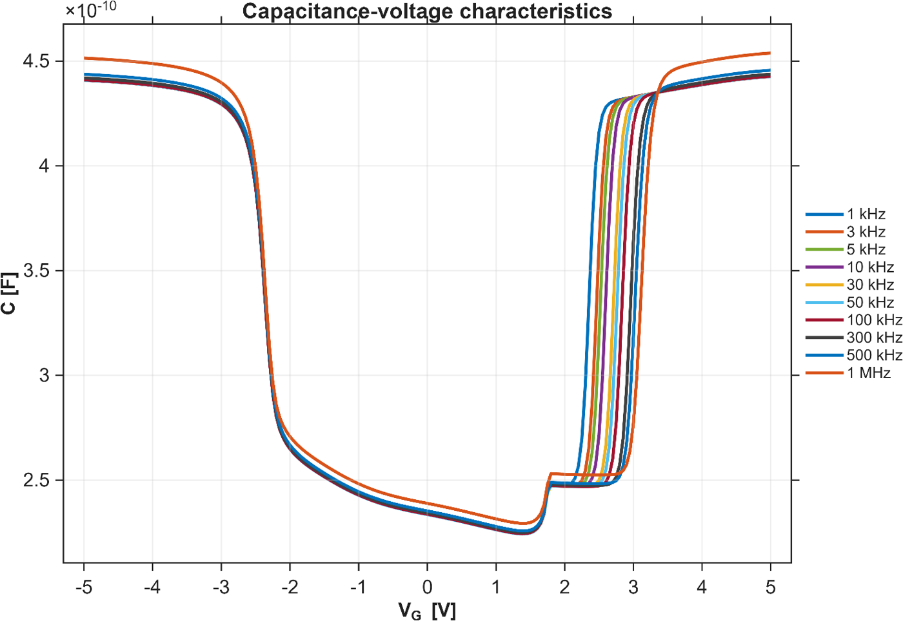</td>
<td width="50%">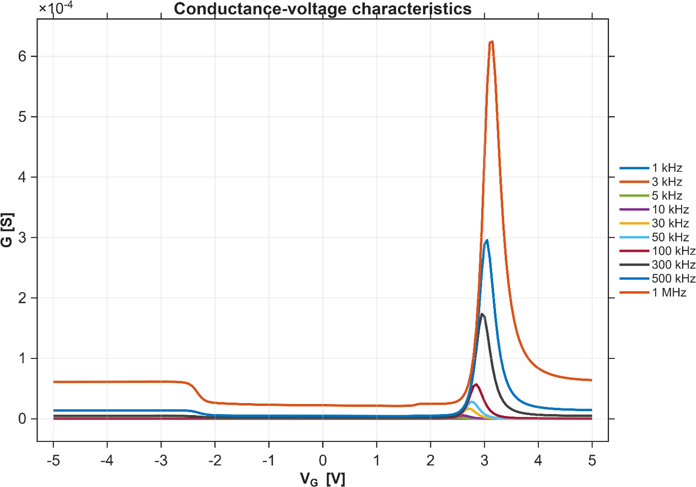</td>
</tr>
<tr>
<td align="center">C–V, 1 kHz to 1 MHz</td>
<td align="center">G–V, 1 kHz to 1 MHz</td>
</tr>
<tr>
<td width="50%">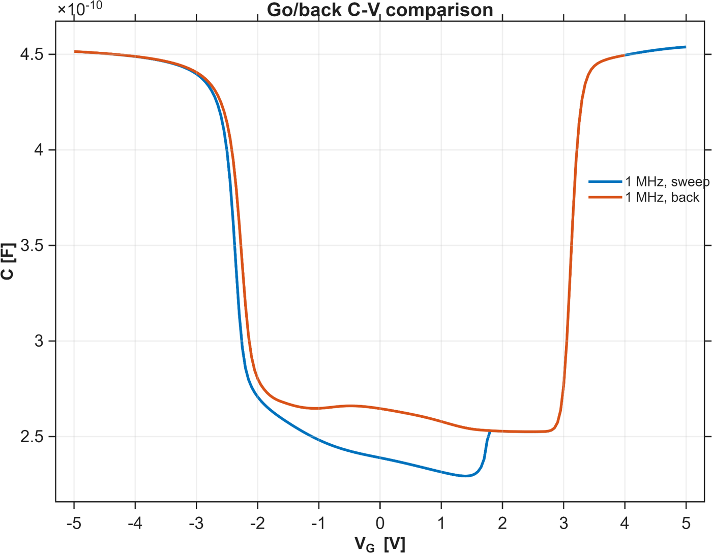</td>
<td width="50%"></td>
</tr>
<tr>
<td align="center">Forward/backward sweep at 1 MHz</td>
<td align="center">tox and NA extraction</td>
</tr>
</table>

Authors: L. Ferrari, A. Maghsoud, S. Sbrescia
